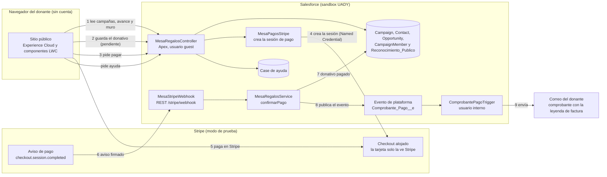
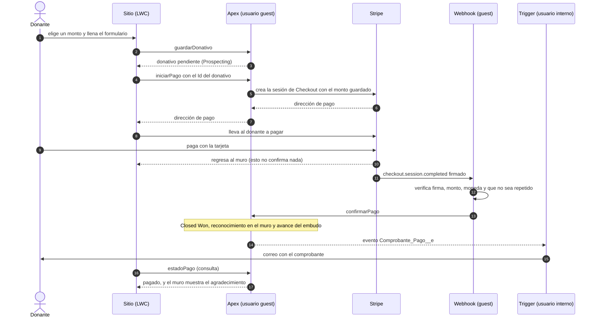
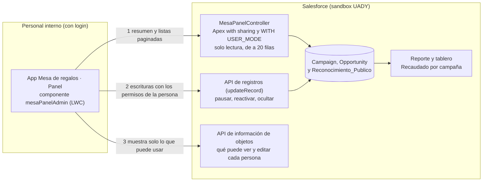

# Arquitectura y flujo de pago

Cómo se conectan las piezas del sitio y del panel interno, quién corre cada cosa y qué pasa desde que alguien dona hasta que recibe su comprobante.
El modelo de datos está aparte, en [modelo_datos.md](modelo_datos.md); los permisos y riesgos, en [seguridad.md](seguridad.md).

## 1. Las piezas

## 2. Un pago, paso a paso

## 3. El panel interno

El personal administra todo desde Salesforce, en la app **Mesa de regalos · Panel**, con el mismo diseño del sitio público. Es una sola pestaña (`Panel_Admin`) que muestra el componente `mesaPanelAdmin`, con una barra lateral y cuatro secciones: Resumen, Campañas, Moderar muro y Donativos.

| Sección | Qué hace | Cómo lo hace |
|---|---|---|
| **Resumen** | Recaudado, campañas activas, reconocimientos visibles y ocultos, avance por campaña y últimos reconocimientos | `obtenerResumen`: solo cuenta donativos *Closed Won* con campaña, igual que el sitio, y cada parte se calcula solo si la persona puede leer ese objeto |
| **Campañas** | Tarjetas con avance, filtros (activas, pausadas, cerradas), «Nueva campaña», Editar, Pausar y Reactivar | «Nueva campaña» abre el formulario del tipo de registro *Campaña de donación*, que lleva los campos del sitio (resumen, organiza, imagen) |
| **Moderar muro** | Lista de reconocimientos con filtro, buscador por nombre, Ocultar/Mostrar y Editar nombre | Ocultar cambia `Mostrar_En_Muro__c`; no se borra nada y se puede revertir |
| **Donativos** | Lista con filtro Pagados/Pendientes, buscador y enlace al registro | Solo lectura |

Reportes y Tableros de la app traen el reporte y el tablero **Recaudado por campaña** (carpeta «Mesa de regalos»), que da el mismo total que el Resumen.

## 4. Quién corre cada cosa

| Qué | Corre como | Por qué así |
|---|---|---|
| El sitio (formulario, listado, muro) | Usuario **guest** | Es público y no tiene login. Solo tiene acceso a la clase `MesaRegalosController`; no tiene permisos directos sobre Contact, Opportunity ni Reconocimiento. La clase corre `without sharing` y devuelve solo datos públicos |
| El aviso de Stripe (webhook) | Usuario guest, con el permission set `Mesa_Sitio_Pagos` | Stripe no tiene sesión. Sin una firma válida no lee ni cambia nada |
| El correo del comprobante | Usuario **interno** (Automated Process), por un trigger del evento | El guest no puede enviar correos y no se le dio ese permiso |
| La administración (campañas, donativos, moderación) | Personal interno con `Mesa_Regalos_Admin`, `Gestor_Campanas`, `Moderador_Muro` o `Tesoreria` | Cada rol ve y edita solo lo suyo |
| El panel interno (`mesaPanelAdmin`) | Cada persona con **su propio usuario**; `MesaPanelController` va `with sharing` y las consultas con `WITH USER_MODE` | A diferencia del sitio, aquí sí se respetan los permisos de cada quien. Las secciones y los botones se esconden si la persona no puede leer, crear o editar ese objeto |

## 5. Decisiones que conviene saber explicar

1. **Un donativo es una Opportunity.** Se crea *pendiente* al registrar la intención y pasa a *Closed Won* solo cuando Stripe lo confirma. Cerrar la ventana o que el banco rechace la tarjeta nunca infla el total.
2. **La página de regreso nunca marca un pago.** Lo único que confirma es el aviso firmado de Stripe (HMAC-SHA256, con tolerancia de 5 minutos). El muro consulta `estadoPago` y solo dice «pagado» cuando el aviso ya llegó.
3. **El monto sale de lo guardado**, no del navegador: el navegador solo manda el Id del donativo.
4. **La clave de Stripe no está en el código.** Vive en una External Credential (cifrada) a la que se llega por una Named Credential; el secreto de la firma vive en una configuración personalizada, fuera del repositorio.
5. **Un aviso repetido no hace nada:** el id de pago de Stripe es único en la Opportunity, así que el mismo pago no confirma dos donativos ni manda dos correos.
6. **El correo sale por un evento de plataforma** porque el pago lo confirma el guest, que no puede enviar correos. El evento lleva solo el Id del donativo, y el resultado queda en `Opportunity.Comprobante_Estado__c`.
7. **El sitio solo publica campañas del tipo de registro «Campaña de donación»**, activas y que ya empezaron. Las demás campañas de la org (NPSP) no se muestran.
8. **Una campaña con donativos pagados no se puede eliminar**: un trigger lo impide, salvo para quien tenga el permiso personalizado `Eliminar_Campanas_Con_Donaciones`. Para dejar de publicarla se pausa (casilla *Active*).
9. **Moderar es ocultar, no borrar.** El panel solo cambia `Mostrar_En_Muro__c`; el reconocimiento sigue existiendo y se puede volver a mostrar.
10. **Las listas del panel se leen de a 20 filas con un cursor** (fecha de creación e Id de la última fila vista), no con `OFFSET`, que se topa en 2,000 filas. Con muchos registros el conteo total y la búsqueda por nombre (`LIKE`) pueden volverse lentos; no se probó con millones de filas.
11. **El panel no depende de nombres de rol.** Pregunta a Salesforce qué puede leer y editar la persona en cada objeto; si no pudiera consultarlo, no esconde nada y el servidor aplica los permisos igual.

## 6. Dónde queda cada dato

| Dato | Dónde | Quién lo ve |
|---|---|---|
| Datos de la tarjeta | Solo en Stripe | Solo Stripe |
| Nombre y correo del donante | `Contact` | Personal interno |
| Monto, visibilidad y consentimiento | `Opportunity` | Personal interno (el monto, también público en el muro) |
| Lo que se muestra en el muro | `Reconocimiento_Publico__c` | Público: nombre y monto, o «Anónimo» y monto |
| Id del pago de Stripe | `Opportunity.Stripe_Pago_Id__c` | Personal interno |
| Mensaje de ayuda | `Case` | Personal con acceso a Case |

## 7. Qué mostrar en una demo de cinco minutos

1. Este diagrama (30 segundos) y [el de objetos](modelo_datos.md#diagrama).
2. Un pago de prueba: el formulario, la tarjeta de prueba de Stripe y el agradecimiento con la referencia.
3. En la org, el donativo en *Closed Won* con su id de Stripe y el estado del comprobante («Enviado»).
4. El correo recibido.
5. El panel interno: el Resumen con el nuevo donativo, ocultar un reconocimiento y ver que desaparece del muro del sitio, y el tablero **Recaudado por campaña**.
6. Una frase sobre por qué la página de regreso no confirma el pago, y otra sobre por qué el panel respeta los permisos de cada persona.
