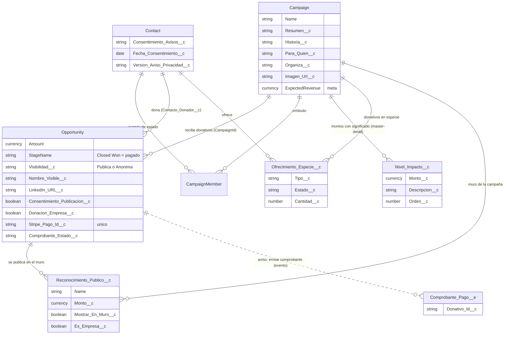

# Modelo de datos

Qué se guarda, en qué objeto y cómo se relaciona. Todo sale de los metadatos del repo (`force-app/main/default/objects`).
La regla de diseño: **reutilizar objetos estándar** y crear objetos propios solo donde el estándar no alcanza.

## Diagrama



## Qué es cada objeto

| Objeto | Estándar o propio | Para qué sirve |
|---|---|---|
| **Campaign** | Estándar, con 5 campos propios | Una campaña de recaudación (*fundraising*). La meta es `ExpectedRevenue`. |
| **Contact** | Estándar, con 3 campos propios | La persona que dona. Guarda su consentimiento de avisos y la versión del aviso de privacidad que aceptó. |
| **Opportunity** | Estándar, con campos propios | **Un donativo.** Se crea al registrar la intención y pasa a *Closed Won* solo cuando Stripe confirma el pago (firma, monto y moneda verificados). |
| **CampaignMember** | Estándar | El embudo del donante dentro de la campaña: Identificado → Contactado → Registrado → Redirigido a donar → Donó. Solo avanza, nunca retrocede. |
| **Reconocimiento_Publico__c** | Propio | Lo que se muestra en el muro. Existe aparte para que el sitio público lea solo nombre y monto, nunca el contacto. |
| **Nivel_Impacto__c** | Propio (detalle de Campaign) | "Con $250 pagas un mes de internet": montos con significado, en orden. |
| **Ofrecimiento_Especie__c** | Propio | Ofrecimientos que no son dinero (equipo, servicios). |
| **Comprobante_Pago__e** | Evento de plataforma | Aviso interno "este donativo se pagó, manda su comprobante". Lleva solo un Id. |
| **Stripe_Config__c** | Custom setting | URL del sitio y secreto del webhook. No está en el diagrama: no se relaciona con ningún registro. |

## Decisiones del modelo (para defenderlas)

1. **Un donativo es una Opportunity, no un objeto propio.** Reutiliza etapas, reportes y el campo Amount. *Closed Won* = pagado; lo demás es intención.
2. **Contacto_Donador__c es Lookup, no Master-Detail.** Un donativo pagado es un registro contable con vida propia: no debe desaparecer en cascada si se borra a la persona, y con Lookup conserva su propio dueño. Es la pregunta de la sesión 3: ¿el hijo tiene audiencia propia?
3. **Nivel_Impacto__c sí es Master-Detail de Campaign:** un nivel no tiene sentido sin su campaña y se borra con ella.
4. **El muro lee de Reconocimiento_Publico__c, no de Opportunity.** Los donativos anónimos tienen su fila (para sumar el total) pero no se listan: el sitio solo devuelve la suma.
5. **Anónimo no significa "no guardar los datos".** El correo se guarda siempre para el comprobante; lo que cambia es lo que se publica.
6. **El comprobante sale por un evento de plataforma** porque el pago lo confirma el usuario *guest* del sitio, que no puede enviar correos; el trigger del evento corre como usuario interno (entrada 34 de la bitácora).

## Qué mostrar en la org durante la demo

Después de un pago de prueba, en **Developer Console → Query Editor** (o en la pestaña de cada objeto):

```sql
-- 1. El donativo: pagado, con su referencia de Stripe y el estado del correo
SELECT Id, Amount, StageName, Visibilidad__c, Stripe_Pago_Id__c, Comprobante_Estado__c
FROM Opportunity ORDER BY CreatedDate DESC LIMIT 3

-- 2. La persona y su consentimiento
SELECT Name, Email, Consentimiento_Avisos__c, Version_Aviso_Privacidad__c
FROM Contact ORDER BY CreatedDate DESC LIMIT 3

-- 3. Lo que aparece en el muro (los anónimos solo suman)
SELECT Name, Monto__c, Mostrar_En_Muro__c, Donativo__r.Visibilidad__c
FROM Reconocimiento_Publico__c ORDER BY CreatedDate DESC LIMIT 5

-- 4. El avance del donante en el embudo
SELECT Contact.Name, Campaign.Name, Status FROM CampaignMember ORDER BY LastModifiedDate DESC LIMIT 3
```

Orden sugerido para 5 minutos: el diagrama (30 s) → el pago en el sitio con una captura (30 s) → la Opportunity en *Closed Won* con `Stripe_Pago_Id__c` y `Comprobante_Estado__c = Enviado` → el correo recibido → una frase sobre la firma del webhook.
